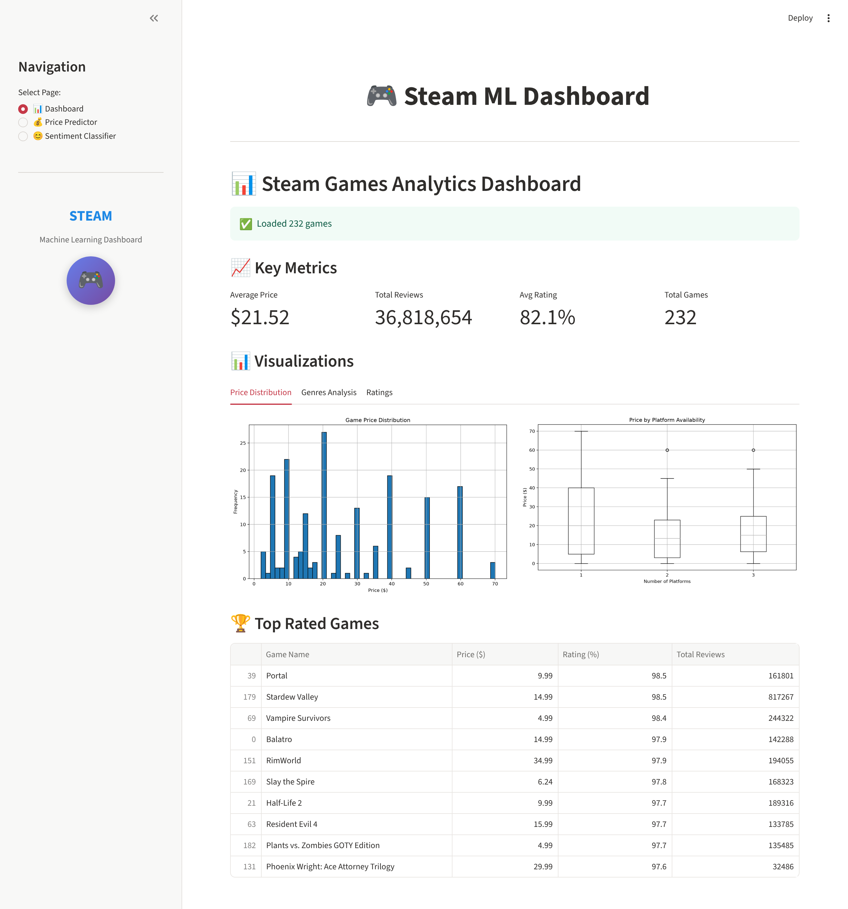
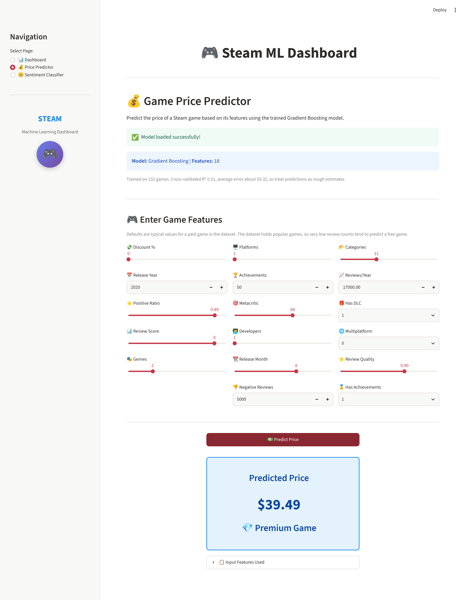
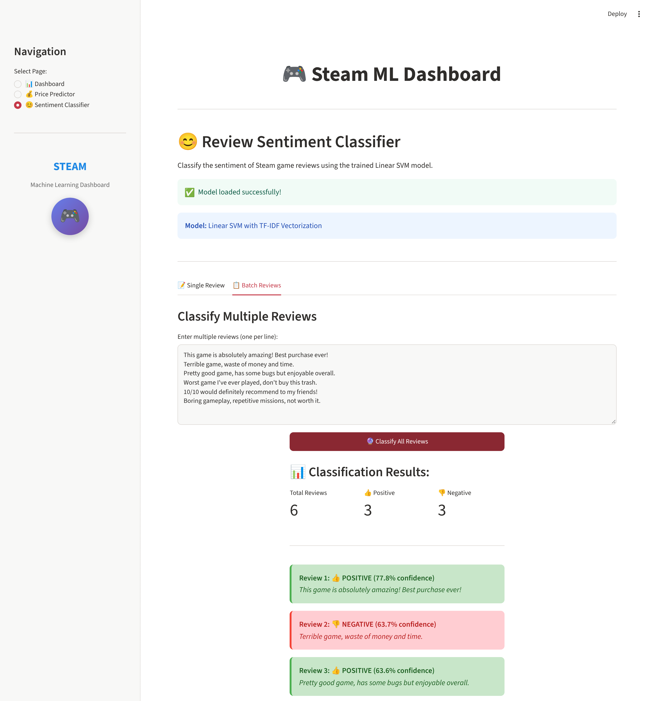
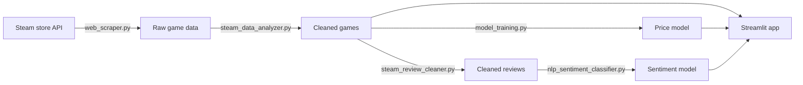

# Steam ML Dashboard

An end-to-end machine learning project on Steam games: collect data from the Steam store, clean it, then serve analytics, price prediction and review sentiment classification in a Streamlit app.

**Author:** Wissem Bahrouni

[](https://steam-ml-dashboard-8ylerqy9appwvhyjm6yeuht.streamlit.app/)

**Live demo:** [Steam ML Dashboard](https://steam-ml-dashboard-8ylerqy9appwvhyjm6yeuht.streamlit.app/)


## Features

- **Analytics dashboard:** key metrics, price, genre and rating charts, and the top-rated games.
- **Price predictor:** estimates a game's price from 18 features using Gradient Boosting.
- **Sentiment classifier:** labels one review or a batch as positive or negative using TF-IDF and Linear SVM.

| Price predictor | Sentiment classifier |
| --- | --- |
|  |  |

## Pipeline



## Data

| File | Contents | Size |
| --- | --- | --- |
| `data/steam_ml_dataset_new_english.csv` | Raw scrape, no header row | 347 games, 30 columns |
| `data/steam_cleaned_data.csv` | Cleaned games used for the app and price model | 232 games, 37 columns |
| `data/steam_reviews_cleaned_final.csv` | Cleaned English reviews, balanced by undersampling | 3,944 reviews (1,972 positive, 1,972 negative) |

Data comes from the public Steam store endpoints and is used for educational purposes.

The cleaned games file and the raw file come from different scrapes. Rebuilding from the raw file also gives 232 games, but 42 of them differ and some prices change. The cleaning step uses 2024 as the current year, which drops the 112 raw games released in 2025.

## Results

### Price prediction

232 games and 18 features. The target is the current price, `price_final`. `price_initial` is excluded because it leaks the target. Cross-validation is 5-fold repeated 10 times. The test column is a single 80/20 split.

| Model | CV R² | CV MAE | Test R² | Train R² |
| --- | --- | --- | --- | --- |
| **Gradient Boosting** | 0.511 ± 0.145 | $9.32 | 0.588 | 0.978 |
| Random Forest | 0.495 ± 0.129 | $9.73 | 0.530 | 0.660 |
| SVR | 0.456 ± 0.084 | $10.30 | 0.394 | 0.668 |
| ElasticNet | 0.426 ± 0.115 | $11.12 | 0.471 | 0.524 |
| Lasso Regression | 0.423 ± 0.122 | $11.14 | 0.468 | 0.529 |
| Ridge Regression | 0.416 ± 0.124 | $11.22 | 0.457 | 0.530 |
| Linear Regression | 0.413 ± 0.126 | $11.26 | 0.455 | 0.530 |
| Decision Tree | 0.384 ± 0.169 | $10.19 | 0.348 | 0.686 |

The app uses **Gradient Boosting**, the best model by test R². Its cross-validated R² of 0.51 is the more reliable figure, and its average error is about $9.32. The gap to its train R² of 0.98 shows clear overfitting.

### Sentiment classification

3,944 reviews, TF-IDF with up to 5,000 unigrams and bigrams. Test metrics use a stratified 80/20 split. "Unseen-game CV F1" keeps all reviews of a game in the same fold, which better reflects reviews of games the model has never seen.

| Model | Test F1 | Test accuracy | Test ROC-AUC | CV F1 | Unseen-game CV F1 | Train accuracy |
| --- | --- | --- | --- | --- | --- | --- |
| **Linear SVM** | 0.851 | 0.852 | 0.922 | 0.841 | 0.820 | 0.997 |
| Logistic Regression | 0.850 | 0.852 | 0.930 | 0.847 | 0.834 | 0.935 |
| Naive Bayes | 0.838 | 0.842 | 0.931 | 0.841 | 0.826 | 0.918 |
| Random Forest | 0.806 | 0.805 | 0.881 | 0.804 | 0.799 | 0.948 |
| Gradient Boosting | 0.788 | 0.790 | 0.868 | 0.789 | 0.778 | 0.944 |

The app uses **Linear SVM**, the best model by test F1. The top two are effectively tied on test F1, and Logistic Regression scores higher on CV F1 (0.847 vs 0.841) with less overfitting. Confidence values for Linear SVM are a sigmoid of its decision score, not calibrated probabilities.

All of these numbers are written to `models/metrics.json` by `train_all_models.py`.

## Limitations

- **Small dataset:** 232 games is few for price prediction, which is why the R² varies so much between folds.
- **Popular games only:** the dataset is mostly well-known titles, so predictions for obscure games are unreliable. Low review counts tend to predict a free game.
- **Reviews drive the price model:** review volume is its strongest signal, so it reflects popularity rather than what a game should cost.
- **Negation is lost:** the English stop-word list removes "not", so "not good" and "good" get the same score.

## Run locally

Tested with Python 3.12.

```bash
git clone https://github.com/wissou11/steam-ml-dashboard.git
cd steam-ml-dashboard
python -m venv .venv
source .venv/bin/activate   # Windows: .venv\Scripts\activate
pip install -r requirements.txt
streamlit run app.py
```

Trained models are included, so the app runs without training. To rebuild:

```bash
python train_all_models.py   # retrain models and rewrite models/metrics.json
python prepare_data.py       # rebuild cleaned data from the raw file into outputs/
python prepare_data.py --games data/steam_cleaned_data.csv   # reproduces the committed reviews file
```

If you change the `scikit-learn` version, retrain the models, since saved models are tied to the version that created them.

## Project structure

```
├── app.py                          Streamlit app
├── train_all_models.py             Trains and saves both models
├── prepare_data.py                 Rebuilds the cleaned datasets
├── requirements.txt
├── assets/                         README screenshots
├── data/                           Raw and cleaned datasets
├── models/                         Trained models and metrics.json
└── src/
    ├── web_scraper.py              Steam data collection
    ├── steam_data_analyzer.py      Cleaning, EDA, correlation, PCA
    ├── steam_review_cleaner.py     Review extraction, cleaning, balancing
    ├── model_training.py           Price model comparison
    └── nlp_sentiment_classifier.py Sentiment model comparison
```

## Tech stack

Python, pandas, NumPy, scikit-learn, Streamlit, Matplotlib, seaborn, Requests, Beautiful Soup
